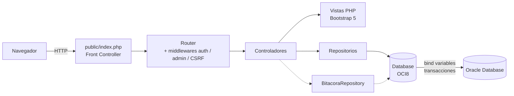
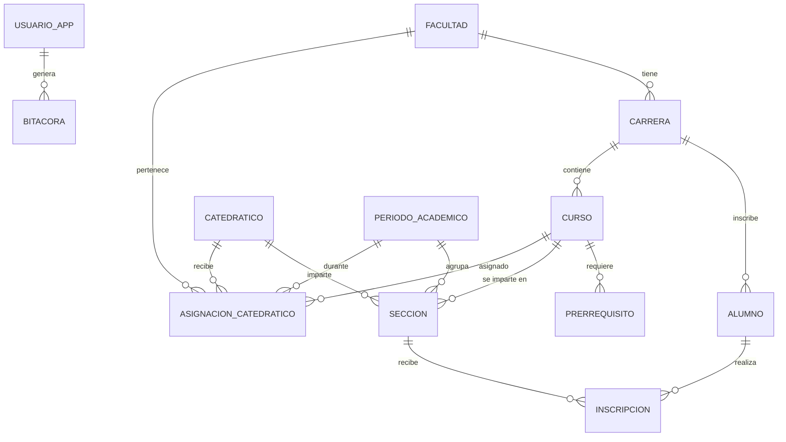

<div align="center">

# 🎓 Sistema Académico UMG

**Portal web de gestión académica sobre Oracle Database**
Proyecto universitario · Ingeniería en Sistemas · Universidad Mariano Gálvez de Guatemala


</div>

---

## 📋 Descripción

Aplicación web desarrollada en **PHP 8 puro (sin frameworks)** que se conecta a una base de datos
**Oracle** mediante la extensión **OCI8**. Permite **visualizar, crear, modificar y eliminar** la
información académica de la universidad (facultades, carreras, alumnos, catedráticos, cursos,
prerrequisitos, secciones, inscripciones y asignaciones), siempre que el usuario se haya
**autenticado** y cuente con el **rol de administrador**.

El proyecto aplica una arquitectura en capas (Front Controller + MVC + Repositorios), buenas
prácticas de seguridad (OWASP) y aprovecha las características propias de Oracle: restricciones,
secuencias, vistas, transacciones y bloqueo de filas.

> ⚠️ Proyecto académico de demostración. No es un sistema oficial de la Universidad Mariano Gálvez de Guatemala.

---

## ✨ Funcionalidades

| Módulo | Descripción |
|---|---|
| 🔐 **Autenticación** | Login con `password_hash`/`password_verify` (bcrypt), bloqueo tras intentos fallidos, expiración de sesión por inactividad. |
| 👥 **Roles** | `ADMIN` (lectura y escritura) y `CONSULTA` (solo lectura). Las rutas de escritura están protegidas en el servidor. |
| 📊 **Panel principal** | Resumen del ciclo redactado como un acta, con cifras enlazadas, ocupación de secciones, alumnos por carrera, estado de inscripciones y promedios por curso dibujados como barras dentro de renglones. |
| 🗂️ **CRUD genérico** | 10 catálogos con búsqueda, filtros, ordenamiento, paginación del lado del servidor y exportación a CSV. Construido a partir de metadatos (`config/entidades.php`). |
| 🧾 **Ficha del alumno** | Historial académico, cursos aprobados, créditos acumulados y promedio. |
| 📈 **Reportes** | Basados en las vistas `VW_ALUMNOS_CARRERA`, `VW_SECCIONES_DISPONIBLES` y `VW_HISTORIAL_ACADEMICO`, con filtros, impresión y CSV. |
| 🛡️ **Usuarios** | Administración de cuentas: alta, edición, rol, activación, restablecimiento de contraseña y desbloqueo. |
| 🕵️ **Bitácora** | Auditoría de inicios de sesión, intentos fallidos y cada `INSERT`/`UPDATE`/`DELETE` (con el detalle de los valores modificados). |

---

## 🏗️ Arquitectura



```
umg-sistema-academico/
├── app/
│   ├── Auth/            # Autenticación, roles y política de contraseñas
│   ├── Controllers/     # Lógica de cada módulo (CRUD, reportes, usuarios...)
│   ├── Core/            # Router, Request, Session, CSRF, View, Database (OCI8)
│   ├── Repositories/    # Acceso a datos con SQL parametrizado
│   ├── Support/         # Validador, traductor de errores ORA, paginador, helpers
│   └── bootstrap.php    # Autoloader PSR-4 y carga de configuración
├── bin/                 # Herramienta de consola para gestionar usuarios
├── config/              # app, database, entidades (metadatos CRUD), reportes, rutas
├── database/            # Scripts SQL (ejecutar en orden 01 → 02 → 03)
├── docker/              # Dockerfile PHP+OCI8 e inicialización de Oracle
├── public/              # Único directorio expuesto (DocumentRoot)
│   └── assets/          # CSS, JS, imágenes
└── views/               # Plantillas (layouts, parciales y módulos)
```

### Modelo de datos



---

## 🔒 Seguridad implementada

- **Inyección SQL:** todas las consultas usan *bind variables* de OCI8; los nombres de tablas y columnas provienen de una lista blanca (`config/entidades.php`).
- **Contraseñas:** hash **bcrypt** (`PASSWORD_DEFAULT`), re-hash automático, política de complejidad y tiempo de respuesta uniforme ante usuarios inexistentes.
- **Fuerza bruta:** bloqueo temporal de la cuenta tras *N* intentos fallidos (configurable).
- **Sesión:** cookie `HttpOnly` + `SameSite=Lax` (+ `Secure` bajo HTTPS), modo estricto, regeneración del ID al iniciar sesión y expiración por inactividad.
- **CSRF:** token sincronizado obligatorio en **todas** las peticiones `POST`.
- **XSS:** escape sistemático de la salida (`htmlspecialchars`) y **Content-Security-Policy** sin scripts en línea.
- **Autorización:** middleware `admin` en el servidor para toda operación de escritura (no solo se ocultan botones).
- **Cabeceras:** `X-Frame-Options`, `X-Content-Type-Options`, `Referrer-Policy`, `Permissions-Policy`; integridad SRI en los recursos CDN.
- **Integridad de datos:** transacciones con `COMMIT`/`ROLLBACK`, `SELECT ... FOR UPDATE NOWAIT` para evitar actualizaciones perdidas y traducción de errores `ORA-xxxxx` a mensajes comprensibles.
- **CSV injection:** neutralización de fórmulas al exportar.
- **Configuración:** credenciales en `.env` (excluido de Git); solo `/public` es accesible desde la web.

---

## 🚀 Instalación

### Opción A — Docker (recomendada, todo incluido)

Requisitos: [Docker Desktop](https://www.docker.com/products/docker-desktop/).

```bash
git clone https://github.com/<tu-usuario>/umg-sistema-academico.git
cd umg-sistema-academico
docker compose up -d --build
```

La primera vez Oracle tarda unos minutos en inicializarse (crea la base y ejecuta los scripts de
`/database`). Puede seguir el progreso con `docker compose logs -f oracle`. Cuando aparezca
`DATABASE IS READY TO USE!`, abra **http://localhost:8080**.

### Opción B — Instalación manual (XAMPP / WAMP + Oracle XE)

1. **Base de datos.** En Oracle XE 21c (o 23ai Free) ejecute, en este orden:
   | Script | Conectado como |
   |---|---|
   | `database/01_crear_usuario.sql` | `SYSTEM` (en la PDB `XEPDB1`/`FREEPDB1`) |
   | `database/02_esquema_y_datos.sql` | `UMG_ACADEMICO` |
   | `database/03_seguridad_aplicacion.sql` | `UMG_ACADEMICO` |

   > En SQL Developer use **Ejecutar script (F5)**. En SQL\*Plus ejecute `SET DEFINE OFF` antes.

2. **Extensión OCI8 para PHP (Windows):**
   - Descargue **Oracle Instant Client Basic** (64 bits) y descomprímalo, p. ej. en `C:\oracle\instantclient_23_x`; agregue esa carpeta a la variable de entorno `PATH`.
   - Habilite la extensión en `php.ini` (`extension=oci8_19` o el nombre de la DLL disponible en `php\ext`). Si su distribución de PHP no la incluye, descargue la DLL `php_oci8` que coincida con su versión de PHP (x64, Thread Safe) desde [PECL](https://pecl.php.net/package/oci8).
   - Reinicie Apache y verifique con `php -m | findstr oci8`.

3. **Aplicación:**
   ```bash
   cp .env.example .env      # Windows: copy .env.example .env
   ```
   Ajuste `DB_HOST`, `DB_PORT`, `DB_SERVICE` y `DB_PASSWORD` en `.env`.

4. **Servidor web:** copie el proyecto a `C:\xampp\htdocs\umg-sistema-academico` y abra
   `http://localhost/umg-sistema-academico/` (el `.htaccess` raíz redirige a `/public`; requiere `mod_rewrite`).
   Alternativa rápida sin Apache:
   ```bash
   php -S localhost:8000 -t public
   ```

---

## 🔑 Credenciales de demostración

| Usuario | Contraseña | Rol | Permisos |
|---|---|---|---|
| `admin` | `Admin#2026` | ADMIN | Ver, crear, modificar y eliminar; usuarios y bitácora |
| `consulta` | `Consulta#2026` | CONSULTA | Solo lectura |

> Cambie estas contraseñas desde **Mi perfil** o con la herramienta de consola antes de exponer el sistema.

### Gestión de usuarios por consola

```bash
php bin/crear_usuario.php jperez ADMIN "Juan Pérez" jperez@umg.edu.gt
php bin/crear_usuario.php --reset admin
```

---

## ⚙️ Variables de entorno

| Variable | Descripción | Valor por defecto |
|---|---|---|
| `APP_ENV` | `production`, `development` o `demo` | `production` |
| `APP_DEBUG` | Muestra detalles técnicos de los errores | `false` |
| `APP_SHOW_DEMO_CREDENTIALS` | Muestra las credenciales de prueba en el login | `false` |
| `DB_HOST` / `DB_PORT` / `DB_SERVICE` | Cadena Easy Connect de Oracle | `localhost` / `1521` / `XEPDB1` |
| `DB_USERNAME` / `DB_PASSWORD` | Usuario del esquema | `umg_academico` |
| `SESSION_IDLE_TIMEOUT` | Segundos de inactividad antes de cerrar la sesión | `1800` |
| `LOGIN_MAX_ATTEMPTS` / `LOGIN_LOCK_MINUTES` | Política de bloqueo | `5` / `15` |

---

## 🧩 Agregar un nuevo catálogo

El CRUD es dirigido por metadatos. Para administrar una nueva tabla basta con declararla en
`config/entidades.php` (columnas, tipos, validaciones, llaves foráneas y filtros); el listado, el
formulario, la validación, el SQL y la auditoría se generan automáticamente.

```php
'aulas' => [
    'tabla' => 'AULA', 'titulo' => 'Aulas', 'singular' => 'Aula', 'icono' => 'bi-door-open',
    'grupo' => 'Estructura institucional', 'pk' => ['PK_AULAID'], 'secuencia' => 'SEQ_AULA',
    'listado' => ['CODIGO', 'CAPACIDAD'], 'busqueda' => ['CODIGO'],
    'campos' => [
        'PK_AULAID' => ['etiqueta' => 'ID', 'tipo' => 'number', 'auto' => true],
        'CODIGO'    => ['etiqueta' => 'Código', 'tipo' => 'text', 'requerido' => true, 'max' => 20],
        'CAPACIDAD' => ['etiqueta' => 'Capacidad', 'tipo' => 'number', 'min' => 1, 'maxValor' => 500],
    ],
],
```

---

## 🛠️ Tecnologías

- **Backend:** PHP 8.1+ (tipado estricto, propiedades `readonly`, `match`, tipo `never`), OCI8.
- **Base de datos:** Oracle Database XE 21c / 23ai Free — tablas, restricciones, secuencias, vistas.
- **Frontend:** Bootstrap 5.3 (solo rejilla y componentes), tipografías Alegreya y Alegreya Sans, JavaScript sin dependencias. El sistema visual «Libro de actas» está documentado en [`docs/diseno.md`](docs/diseno.md).
- **Infraestructura:** Docker, Docker Compose, Apache 2.4, GitHub Actions (lint en PHP 8.1–8.4).

---

## 🖼️ Logotipo institucional

El sello de la universidad se incluye en `public/assets/img/logo-umg.webp` (256 px, optimizado) y
`favicon-umg.png`. El portal detecta automáticamente cualquier archivo `logo-umg.svg|png|webp|jpg` en esa
carpeta y lo muestra en el menú lateral y en la pantalla de inicio de sesión; si no existe, usa un
ícono genérico.

> El logotipo de la Universidad Mariano Gálvez de Guatemala es propiedad de la universidad y se
> utiliza con autorización únicamente con fines académicos y demostrativos.

---

## 👤 Autor

| Nombre | Carné | Rol |
|---|---|---|
| **Samuel Isaac Guzman Citalan** | 5090-24-756 | Análisis, diseño y desarrollo |

Ingeniería en Sistemas · Universidad Mariano Gálvez de Guatemala, 2026.

## 📄 Licencia

Distribuido bajo la licencia MIT. Consulte [`LICENSE`](LICENSE).
